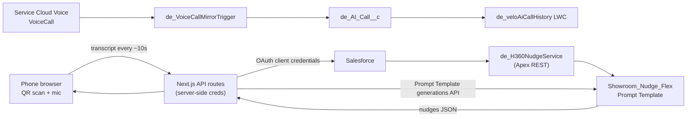

# Scan & Speak

Scan a customer's QR code at a service centre, see their Customer 360 on your phone, record the conversation, and get live AI nudges every ~10 seconds. Built for the fictional dealer group **Velo Motors**.

## What it does

- **Mobile web app (`customer360-app/`, Next.js)**: scan a QR code with the phone camera, load that customer's Customer 360 (profile, vehicles, cases, appointments, history), record the conversation with the Web Speech API, and send the transcript to Salesforce every ~10 seconds. A Prompt Template returns next-best-action nudges, which the app shows live.
- **Server-side proxy**: the Next.js API routes (`app/api/*`) hold the Salesforce credentials (OAuth 2.0 client credentials). The browser never sees a token. With no env vars set, the app runs on built-in mock data.
- **Salesforce side (`force-app/`)**: Apex REST and prompt-template services for nudges, a Lead record page with call history and lead cards (LWC), a showroom "nudge theater" demo, a VoiceCall-to-custom-object mirror, and two Hindi voice agents (Agent Script).

## Architecture



## Components

| Component | Purpose |
|---|---|
| `customer360-app/` | Next.js mobile app: QR scanner, Customer 360 view, recorder, live nudges |
| `customer360-app/lib/salesforce.js` | Server-side Salesforce client (token, record reads, prompt template calls); falls back to `lib/mock.js` |
| `de_H360NudgeService` | Apex REST `/nudge`: returns nudges for a record and transcript chunk |
| `de_ShowroomNudgeService` | Runs the `Showroom_Nudge_Flex` Prompt Template with rolling context |
| `Showroom_Nudge_Flex` | Prompt Template that returns a structured coaching nudge |
| `de_showroomNudgeTheater` | LWC that replays a scripted showroom conversation and shows the nudges |
| `de_VeloVoiceCallController`, `de_VoiceConnectService` | Lead call history: recordings and live transcripts from the Voice Connect API |
| `de_VoiceCallMirror`, `de_VoiceCallMirrorTrigger`, `de_AI_Call__c` | Mirror feature-gated VoiceCall rows to a readable custom object |
| `de_VoiceCallHistoryApi` | Apex REST `/de/voicecalls` for the app's call history |
| `de_UpdateLeadFromCall`, `de_FaqLlmAnswer` | Agent actions: write call outcomes to the Lead; answer FAQs through the Models API |
| `de_velo*` LWCs | Lead record page cards: contact, details, score, status bar, communication timeline, AI and human call history |
| `de_recordQrCode` | Generates the QR code a customer shows at the centre |
| `Velo_Voice_Agent`, `Velo_Voice_Sales_Agent` | Hindi voice agents (outbound qualification, inbound sales) |
| `Velo_Lead_Record_Page` | Flexipage that assembles the Lead cards |

## Prerequisites

- Salesforce CLI (`sf`) and a Salesforce org with Agentforce, Prompt Builder and (for call history) Service Cloud Voice
- Node.js 18+ for the web app
- An External Client App or Connected App with the OAuth client credentials flow enabled

## Setup and deploy

```bash
# Salesforce metadata
sf project deploy start --source-dir force-app --target-org <alias>

# Web app
cd customer360-app
cp .env.example .env.local
npm install && npm run dev      # http://localhost:3000
```

Use "Use demo customer" on the scan page to explore without an org.

## Configuration

| Item | Where | What to set |
|---|---|---|
| `SF_LOGIN_URL`, `SF_CLIENT_ID`, `SF_CLIENT_SECRET`, `SF_API_VERSION` | `customer360-app/.env.local` | Org My Domain URL and OAuth client credentials. See `.env.example`. |
| `SF_NUDGE_RECORD_ID`, `SF_NUDGE_SESSION_ID`, `SF_NUDGE_APEX_PATH`, `USE_MOCK` | `customer360-app/.env.local` | Optional. The nudge record sync is skipped when `SF_NUDGE_RECORD_ID` is empty. |
| `de_Voice_Connect__mdt.Default` | Setup > Custom Metadata Types | Replace `REPLACE_ME` for Consumer Key, Consumer Secret and Run As Username. |
| Remote Site `de_VoiceConnect` | Setup > Remote Site Settings | Replace `REPLACE_ME` with your My Domain host. |
| Agent users | `Velo_Voice_Agent.agent`, `Velo_Voice_Sales_Agent.agent` | Set `default_agent_user` to a real Einstein Agent user (placeholder: `velo_voice_agent@example.com`). |
| Prompt Templates | Prompt Builder | `Showroom_Nudge_Flex` is included. The pitch and coach routes call `Personalized_Pitch_Suggestion` and `Sales_Pitch_Coach`, which are not included; those routes fall back to demo content. |
| Permission sets | Setup | Assign `de_Showroom_Nudge_Access`, `de_AI_Call_Access` and `de_QR_Code_Access` to your users. |

## Screenshots

Add screenshots to `docs/screenshots/` (scan screen, Customer 360, live nudges, Lead record page).

## License

MIT. See [LICENSE](LICENSE).
